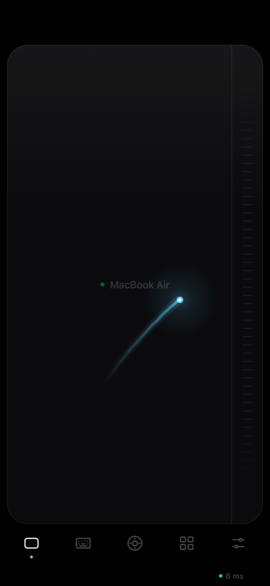
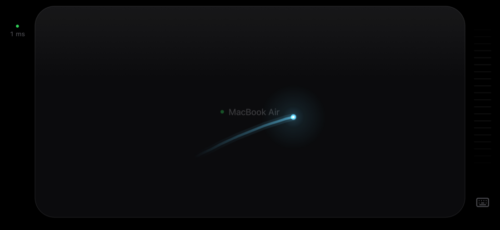
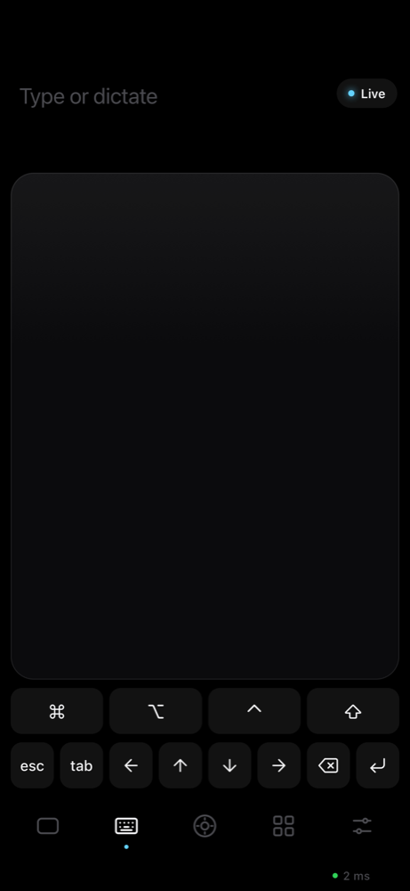
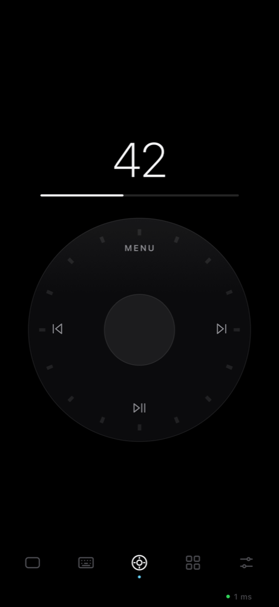

# Rackpad

Your phone becomes a trackpad, keyboard and remote for your Mac. Lie back,
hold the phone in one hand, and drive the Mac from across the room. It runs
in the phone's browser, so there's no App Store app, and nothing ever leaves
your Wi-Fi: no cloud, no account.

| Trackpad | Sideways: a Magic Trackpad | Keys | Remote |
| :---: | :---: | :---: | :---: |
|  |  |  |  |

## What it does

- **A trackpad that feels like a Mac's.** Tap to click, two-finger tap to
  right-click, scrolling that keeps gliding after you let go, pinch to zoom,
  three-finger swipes for Mission Control and desktops, tap-then-drag.
- **Turn the phone sideways and it's a Magic Trackpad.** The whole screen is
  one sheet of glass. The empty edge beside it holds a scroll strip and the
  keyboard key, and the round-trip time to your Mac sits above the notch.
- **Made for one thumb.** Hold to right-click, hold and move to drag, and a
  ribbed scroll strip along the edge (left, right or off).
- **Live typing and dictation.** What you type appears on the Mac as you type,
  autocorrect and dictation fixes included. Sticky ⌘ ⌥ ⌃ ⇧, arrows, esc, tab,
  and a strip of trackpad above the keys.
- **Click wheel.** An iPod-style wheel for volume. The centre plays and
  pauses, ⏮ ⏭ skip, MENU mutes.
- **Smart layout.** The app tab wears the icon of the app in front and turns
  into its controls: tabs for browsers, a big mute button for Zoom, Teams and
  Meet, next slide and a timer for Keynote, PowerPoint and Google Slides,
  playback for YouTube, Netflix, Spotify, Music and video players.
- **Quiet by design.** A black or silver glass surface and one accent colour.
  A soft light follows your finger, each click leaves a ring on the phone and
  a ripple on the Mac, and the Mac's cursor glows while the phone drives it,
  so you can find it from the couch.
- **Your Mac's screen on the phone.** The Screen tab shows the Mac live, and
  a tap lands right where you touch the picture: tap to click, hold to
  right-click, drag, scroll with two fingers. It's WebRTC video from the
  Mac's hardware H.264 encoder at up to 60 fps, shown the moment each frame
  arrives. The moon button darkens the Mac's own screen while you watch.
  Needs Screen Recording permission for the app Rackpad runs in.
- **Smooth on real Wi-Fi.** Every touch carries the moment your finger made
  it, and the Mac plays movement back at that pace instead of in the clumps
  Wi-Fi delivers it in (see [How it works](#how-it-works)).

## Get started

You need a Mac with Node.js 18.17 or newer and Apple's Command Line Tools
(`xcode-select --install`). Then, from this folder:

```sh
./start.sh
```

The first start takes about 30 seconds: it installs dependencies, compiles a
small native helper, makes Rackpad's local certificate and opens the pairing
page with a QR code. `start.sh` also keeps the Mac awake while Rackpad runs.

1. **Allow Accessibility.** macOS asks once. Switch on the app you started
   Rackpad from (Terminal, iTerm, Ghostty, VS Code…) in System Settings →
   Privacy & Security → Accessibility. No app can move the pointer or type
   without it.
2. **Scan the QR code** with the phone's camera and open the link. Already
   have Rackpad on the phone? Open it and tap **Scan QR code** instead.
3. **Add it to the Home Screen** (Share → Add to Home Screen). It then opens
   full screen with no browser bars and finds your Mac by itself.

The pairing page lives at <http://localhost:8421/pair>. The QR code points at
your Mac's `.local` name, which works on any network your phone and Mac
share. Some office networks block `.local` names, so the page lists the plain
IP address too.

### Secure connection (once per phone)

Phones only give a web page the microphone and a live camera over HTTPS. Your
Mac serves Rackpad over HTTPS on port 8422 with a certificate of its own. To
trust it, open Rackpad on the phone → Settings → **Secure connection** and
follow the steps:

1. **Download** Rackpad's certificate. Safari asks to allow a configuration
   profile: tap Allow.
2. Settings → General → VPN & Device Management → **Rackpad Local CA** →
   Install.
3. Settings → General → About → Certificate Trust Settings → switch on
   **Rackpad Local CA**.
4. Back in Rackpad: **Open secure Rackpad**, then add that one to the Home
   Screen and delete the old icon.

The certificate is made on your Mac and its key never leaves it
(`~/.rackpad/tls`). It is restricted to `.local` names, `localhost` and
private network addresses, so it can never vouch for a real website: a forged
certificate for apple.com from it is refused (`npm test` checks this against
Apple's own trust rules).

## Best performance

Rackpad already does the work it can: movement is replayed at your finger's
pace, the link is kept warm while you use it, and clicks wait for the pointer
to arrive. What's left is mostly your Wi-Fi. In order of impact:

1. **Pause AirDrop & Handoff while you use it.** They share the Mac's Wi-Fi
   radio and hop it off your network about twice a second; each hop stalls
   Wi-Fi for ~90 ms, and you feel it as a hitch. Start with
   `./start.sh --no-airdrop`: it asks for your password once and keeps them
   paused for the whole session (macOS switches them back on whenever it
   wants them, so it switches them off again within a second), then turns
   them back on when Rackpad quits. `sudo ifconfig awdl0 down` pauses them
   just once. Rackpad warns at start when they're on. Measured on a MacBook
   Air: pings to the router went from spikes of 95 ms every half second to a
   steady 3 ms.
2. **Keep Rackpad in front on the phone.** While you're using it, the phone
   and the Mac swap a tiny message every 20 ms so neither Wi-Fi radio naps. A
   napping radio holds messages: a round trip is ~75 ms with one message a
   second, under 5 ms with one every 20 ms. Thirty seconds after your last
   touch it eases off to save battery, so the first touch after a long pause
   can take a moment.
3. **Use 5 GHz Wi-Fi, near the router.** Avoid guest networks and anything
   with "client isolation", which stops devices from talking to each other.
   If a network blocks that, join the Mac to the phone's Personal Hotspot.
4. **Use it from the Home Screen,** not a Safari tab: full screen, nothing in
   the way, and it reconnects the moment you open it.
5. **Turn off Low Power Mode on the phone** while you use it.

**Reading the ping:** the number on screen (bottom right, or above the notch
sideways) is the round trip to your Mac. Green is under 40 ms, yellow under
100 ms, red above. On good Wi-Fi it reads a few ms.

**Looking closer:** `./start.sh --verbose` logs every command the phone
sends (never what you type) and, every few seconds while you move, a line
like `glide: 155 moves in 3s, 2 late, playing 4 ms behind`. "Playing N ms
behind" is how long Rackpad waits to smooth over Wi-Fi's unevenness. A few ms
means a calm network; tens of ms means Wi-Fi is clumping, usually AirDrop or
a busy channel.

## Gestures

| On the trackpad | Does |
| --- | --- |
| Tap | Click |
| Two-finger tap, or hold and let go | Right-click |
| Hold, then move | Drag |
| Tap, then touch again and move | Drag |
| Two fingers | Scroll, with momentum |
| Pinch | Zoom (⌘+ / ⌘−) |
| Three fingers up / down | Mission Control / App windows |
| Three fingers left / right | Switch desktops |
| Slide along the edge strip | Scroll with one thumb |
| Turn the phone sideways | Full-size trackpad |

## Commands

```
./start.sh [--no-airdrop] [options]     what you normally run
npm start                                the same, without start.sh's checks

Options: --port 8421, --https-port 8422, --no-https, --host <name-or-ip>,
         --pair, --no-open, --dry-run, --verbose   (./start.sh --help)

npx rackpad reset-token     unpair every phone (they scan the QR code again)
npx rackpad build-helper    recompile the native helper
```

## How it works

```
 phone (web app)                         Mac
┌──────────────────┐  WebRTC      ┌───────────────────┐  JSON lines  ┌─────────────────────┐
│ gestures, each   │  data channel│ Node server       │ ───────────▶ │ RackpadHelper       │
│ touch timestamped│ ───────────▶ │ playback at the   │  move/click/ │ (Swift): CGEvent    │
│ live typing diff │  (UDP)       │ finger's pace,    │  scroll/key/ │ input, cursor glow  │
│ click wheel      │ ◀─────────── │ acceleration,     │  text/media  │ and click ripples,  │
│ keeps link warm  │  front app,  │ momentum, layouts │ ◀─────────── │ front-app watcher   │
│                  │  volume      │                   │  front app   │                     │
│ <video> of the   │  WebRTC      │ one WebRTC link   │  H.264 on    │ ScreenCaptureKit →  │
│ Mac's screen     │ ◀─────────── │ per phone         │ ◀─────────── │ VideoToolbox H.264  │
└──────────────────┘  video track └───────────────────┘  fd 3        └─────────────────────┘
```

- `web/` is the phone app: plain ES modules, no build step. Gesture
  recognizers (`gestures.js`), the typing diff (`textdiff.js`) and the wheel
  maths (`wheel.js`) are pure functions with tests.
- `server/engine.js` turns gestures into input. A Bluetooth mouse feels smooth
  because its reports arrive on a steady beat; Wi-Fi delivers in clumps. So
  `Playout` learns the network's quickest trip and how much later most
  messages arrive, and plays every movement that far behind your finger,
  spread evenly across the time it took. On calm Wi-Fi that's a few ms.
- `server/rtc.js` gives each phone one WebRTC link, straight across the
  Wi-Fi, made with
  [libdatachannel](https://github.com/paullouisageneau/libdatachannel). A
  data channel carries touches, keys and pings over UDP, and a send-only
  H.264 track carries the screen: lost packets resent, a fresh keyframe when
  a phone starts watching or loses the picture, and a request for zero
  playout delay so nothing buffers between the Mac and your finger. Setting
  the link up is two HTTP requests: the phone asks for the Mac's offer
  (`POST /rtc`, with its pairing code) and sends back its answer
  (`POST /rtc/answer`). There's no WebSocket, and no JPEG fallback: if no
  picture comes, the phone says so.
- `server/tls.js` runs the local certificate authority and renews the Mac's
  certificate when it joins a new network.
- `helper/RackpadHelper.swift` posts real mouse, scroll, keyboard and
  media-key events, maps shortcuts to your keyboard layout (⌘Z is ⌘Z on
  AZERTY too), draws the cursor glow and ripples as click-through overlays,
  and reports the app in front. While a phone watches, it captures the screen
  only when something changes and encodes it in hardware (constrained
  baseline, no B-frames, low-latency rate control) in about 5 ms.

## Development

```sh
npm run dev     # dry run: nothing is controlled, every command is logged
npm test        # unit tests, plus browser end-to-end tests if Playwright is installed
```

The end-to-end tests drive the real phone page in Chromium with real touch
events, over HTTP and HTTPS, against a dry-run Mac. Install Playwright to run
them: `npm i -D playwright && npx playwright install chromium`.

## Good to know

- **Haptics on iPhone:** iOS 26.5 stopped web pages from triggering haptics,
  so iPhones get none. Android phones vibrate. Real haptics need a native
  iPhone app.
- **Pinch to zoom** sends ⌘+ / ⌘−. A real trackpad's magnify gesture can't be
  created with public macOS APIs.
- **Meeting mute buttons** send each app's own shortcut. Rackpad can't read
  whether you're muted, so the button toggles.
- **The pointer stopped moving after an update:** macOS ties Accessibility to
  the app you run Rackpad from. If it's on but nothing happens, remove that
  app from the Accessibility list with − and add it again.
- **Security:** a phone needs the pairing code from the QR link to connect,
  and the pairing page only opens on the Mac itself. Touches, keys and the
  screen always travel encrypted (WebRTC uses DTLS), but over plain HTTP
  someone on the same network could sniff the pairing code as the phone
  connects. Use the secure connection on networks you don't trust, and
  `rackpad reset-token` to change the code.

## Roadmap

- Hold-to-talk dictation: hold the mic, speak, let go (needs the secure
  connection).
- A live camera scanner for pairing.
- Command palette for any app's menus, an air mouse and laser pointer, and a
  phone dock of your open apps.
- Streaming an external display, not just the built-in one.
- Later, a native iPhone app for real haptics, Apple Watch control and
  lock-screen widgets.
